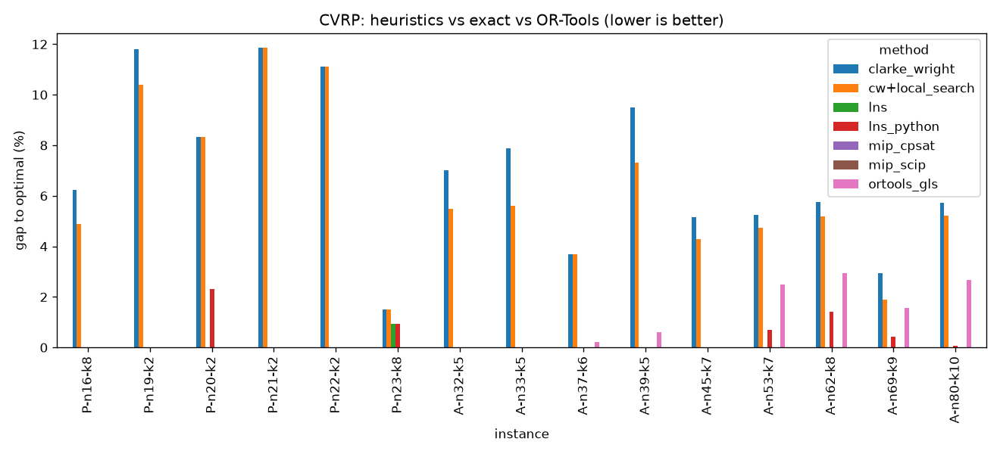

# cvrp-bench

A benchmark for the **Capacitated Vehicle Routing Problem (CVRP)**. It compares construction heuristics, local search, a
large-neighbourhood search (LNS), an exact MIP and Google OR-Tools on 15 CVRPLIB instances with proven optimal solutions.

The solver core is a single dependency-free C++20 file (`cpp/cvrp_solve.cpp`). Python handles everything around it:
downloading the data, running the C++ binary, solving the exact MIP and the OR-Tools baseline, **independently validating
every solution**, and producing the tables and chart.

## The problem

There is one depot and n customers, each with a demand, plus identical trucks of capacity Q. Every customer must be
visited exactly once, each route starts and ends at the depot, and no route's load may exceed Q. The objective is to
minimise total distance. Distances follow the TSPLIB `EUC_2D` rule, which is Euclidean distance **rounded to the nearest
integer**. Without that rounding, the published optimal costs are not reproduced.

## Methods

| method | where | idea |
|---|---|---|
| `nearest_neighbor` | C++ | from the depot, always drive to the closest unvisited customer that still fits |
| `clarke_wright` | C++ | savings algorithm: start with one route per customer, then merge routes end-to-end in order of saving d(0,i)+d(0,j)−d(i,j) |
| `cw+local_search` | C++ | Clarke–Wright, then best-improvement relocate / swap moves plus 2-opt, until no move improves the cost |
| `lns` | C++ | ruin and recreate: remove a customer and its nearest neighbours, reinsert them greedily, run local search, and accept the result with a simulated-annealing rule |
| `lns_python` | Python | **the same LNS** in pure Python, used for the speed comparison |
| `ortools_gls` | Python | OR-Tools routing (savings start + guided local search), default settings |
| `mip_scip`, `mip_cpsat` | Python | exact two-index MIP with MTZ load constraints and a lower bound on the number of trucks, solved by SCIP and by CP-SAT |

## How correctness is checked

- `check_optima.py` reads every published optimal solution, and the parser and cost function reproduce **all 15 optimal costs exactly**.
- `solution.validate` checks every result: each customer visited exactly once, no overloaded truck, no invalid nodes. The
  C++ binary only *searches*. Python re-checks the returned routes and recomputes the cost itself, so a bug in the C++ cannot
  produce an unverified "good" number.
- The C++ heuristics are tested against the Python implementations (`heuristics.py`) and must produce **identical routes on
  all 15 instances**. That test caught a real bug during development: a one-character typo in relocate that silently skipped
  valid moves (cost 828 instead of 827).
- 16 pytest tests, including brute-force optimality on a tiny instance and a proven-optimal MIP result.

## Run

```bash
uv sync                                    # Python 3.12 environment + dependencies
make                                       # builds build/cvrp_solve (clang++ -O2 -std=c++20 -Wall -Wextra)
uv run python -m cvrp_bench.download       # 15 instances + optimal solutions into data/
uv run python check_optima.py              # parser + cost function vs the published optima
make test                                  # rebuild if needed + run the 16 tests
uv run cvrp-bench --compare-python-lns     # full benchmark, ~12 min -> results/
build/cvrp_solve data/A-n32-k5.vrp lns 10 0    # the C++ binary on its own: <file> <nn|cw|ls|lns> [seconds] [seed]
```

## Results

MacBook Air M4, 15 Oct 2026. LNS and OR-Tools get 10 s per instance; the MIP gets 60 s and only runs up to 23 nodes.
**All 102 runs produced feasible solutions.**

| method | mean gap to optimum | optimal on |
|---|---:|---:|
| nearest_neighbor (C++) | 32.59 % | 0 / 15 |
| clarke_wright (C++) | 6.91 % | 0 / 15 |
| cw+local_search (C++) | 6.10 % | 0 / 15 |
| **lns (C++)** | **0.06 %** | **14 / 15** |
| lns (Python, same algorithm) | 0.39 % | 9 / 15 |
| ortools_gls | 0.70 % | 9 / 15 |
| mip_scip | 0.00 % | 6 / 6 (5 proven) |
| mip_cpsat | 0.00 % | 6 / 6 (5 proven) |



Per-instance tables and the C++ vs Python iteration counts are in [`results/summary.md`](results/summary.md). The raw data is in `results/results.csv`.

## Findings

1. **Speed turns into solution quality.** With the same LNS and the same 10 s, C++ runs **17–41× more iterations (median
   38×)**. The mean gap falls from 0.39 % to **0.06 %**, and optimal results rise from 9 to **14 of 15**. Python's misses are
   mostly on the larger instances (A-n53 to A-n80), which is where extra iterations matter most.
2. **Speed doesn't fix everything.** On P-n23-k8, both versions stop at **+0.95 %** (534 vs 529), even though C++ ran about
   1.8 million iterations. The search is trapped, and getting out needs a different neighbourhood or acceptance rule, not more
   iterations.
3. **Exact and heuristic methods complement each other.** On that same instance the MIP **finds the optimum (529)** but cannot
   prove it in 60 s: the lower bound stalls at 444–452, about 15 % below. So the exact method finds what the metaheuristic
   misses, while the metaheuristic scales to sizes the exact method can't.
4. **The MTZ model hits a wall at about 23 nodes.** It proves optimality for n ≤ 22 within 0.3–20 s and then times out. MTZ
   is compact, but its LP relaxation is weak, so the bound improves too slowly. On the same model, **CP-SAT was 3–13× faster than
   SCIP** (e.g. P-n22-k2: 1.4 s vs 18.9 s).
5. **Escaping local optima is what closes the gap.** Savings gets within 6.9 % on average and local search only improves that to 6.1 %.
   The LNS's ruin-and-recreate step plus annealing acceptance takes it to 0.06 %.
6. **OR-Tools degrades with size here.** It stays within 0.6 % of optimal up to 44 customers, then falls to 1.5–3 % off on A-n53 to A-n80. This
   compares OR-Tools' *default* settings against an LNS specialised for CVRP, so it is not a verdict on OR-Tools in general.
7. The speed-up is smallest on P-n16-k8 and P-n23-k8 (17–20×), the two instances with many short routes. One hypothesis,
   not yet tested: each iteration does less work there, so fixed per-iteration costs take a larger share.

## Limitations

- One random seed per run. Time-limited results vary by machine and load.
- Instances have at most 79 customers. Larger CVRPLIB sets (e.g. the X set) would test scaling properly.
- OR-Tools runs with default parameters and up to n−1 vehicles.
- The MIP uses the compact MTZ formulation. Stronger formulations (rounded capacity cuts, branch-and-cut) would prove larger instances.

## Layout

```
cpp/cvrp_solve.cpp          C++ solver: parser, NN, Clarke-Wright, 2-opt, relocate/swap, LNS
src/cvrp_bench/
  download.py               fetch instances + optimal solutions from CVRPLIB
  instance.py               .vrp / .sol parser, rounded EUC_2D distances
  solution.py               route cost, load, feasibility validator
  cpp_solver.py             runs the C++ binary as a subprocess, parses its routes
  heuristics.py             Python twin of the heuristics (test oracle)
  metaheuristic.py          Python twin of the LNS (speed comparison)
  exact.py                  MTZ MIP via OR-Tools (SCIP / CP-SAT)
  ortools_routing.py        OR-Tools routing baseline
  bench.py                  runs everything, writes results/
tests/test_cvrp.py          16 tests
check_optima.py             parser + cost function vs published optima
```

Data: [CVRPLIB](https://galgos.inf.puc-rio.br/cvrplib/), Augerat sets A and P.
